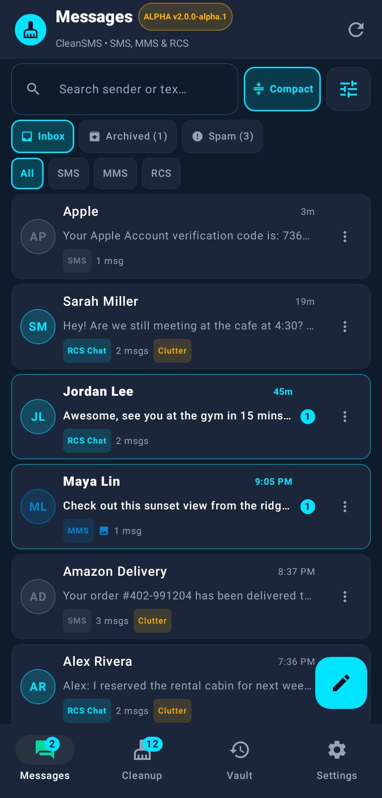
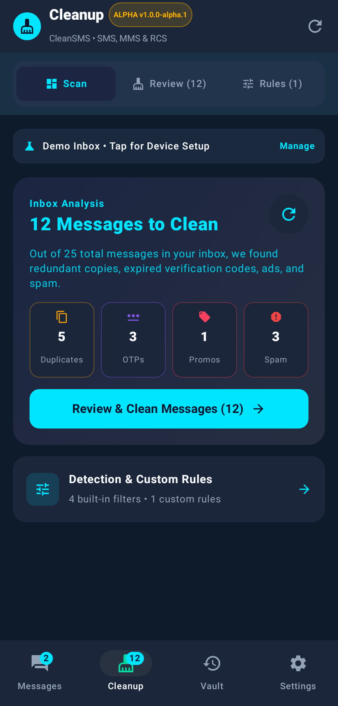
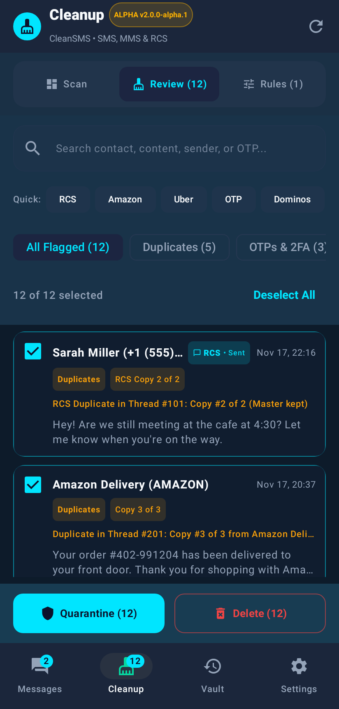
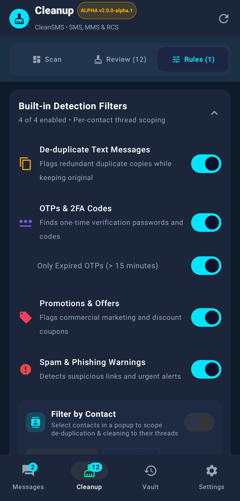
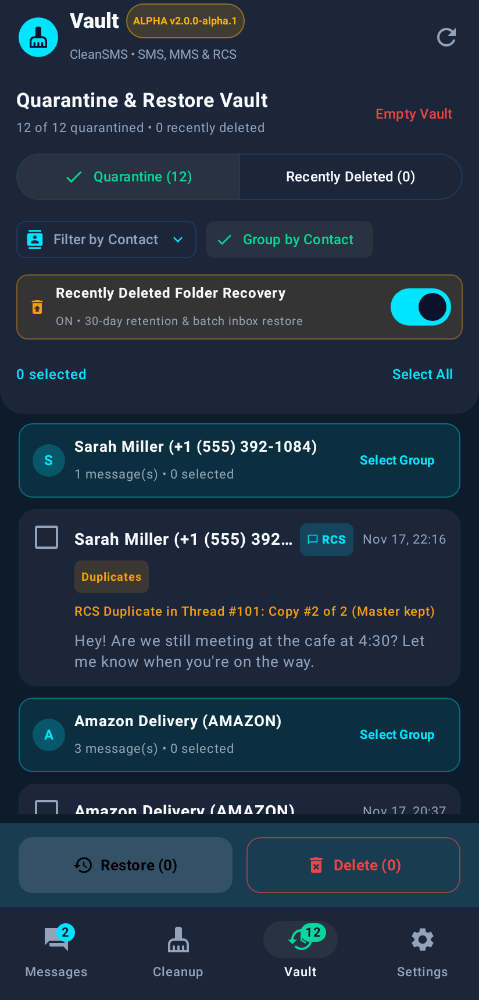
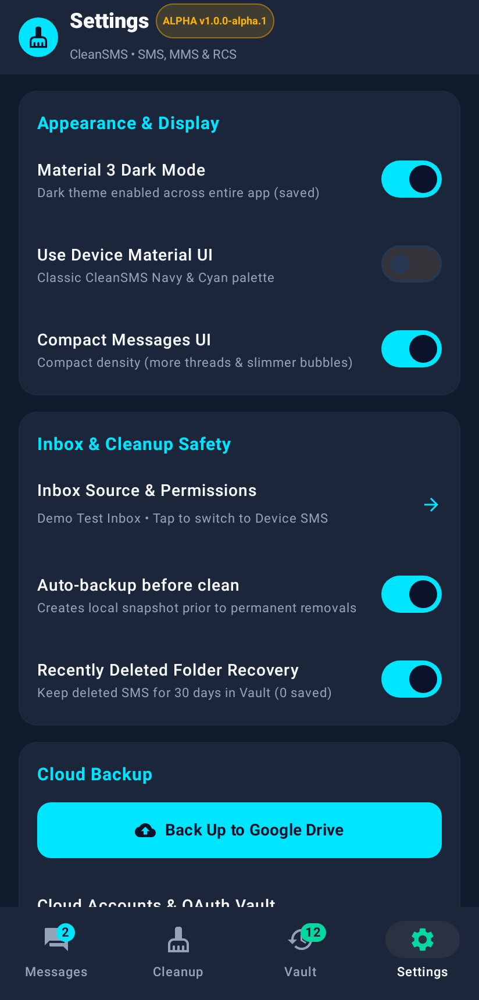

# CleanSMS 💬✨

> **On-device SMS, MMS & RCS message organizer, de-duplicator, and cleaner built with Jetpack Compose and Material Design 3.**

[](https://developer.android.com)
[](https://kotlinlang.org)
[](https://developer.android.com/jetpack/compose)
[-informational?style=flat-square)](https://developer.android.com/about/versions)
[-success?style=flat-square)](https://developer.android.com/about/versions)
[](https://github.com/HussainQ/SMS-Cleaner-Tool)
[](https://github.com/HussainQ/SMS-Cleaner-Tool/releases)
[](LICENSE)

> [!NOTE]
> **Latest Pre-Release (`v2.0.0-alpha.1`)**: See [`RELEASE_NOTES.md`](RELEASE_NOTES.md) or visit [`HussainQ/SMS-Cleaner-Tool/releases`](https://github.com/HussainQ/SMS-Cleaner-Tool/releases) for downloadable APKs and SHA-256 checksums.

---

## 📸 Screenshots

| Messages Inbox | Cleanup • Scan | Cleanup • Review |
| :---: | :---: | :---: |
|  |  |  |

| Cleanup • Rules | Quarantine Vault | Settings |
| :---: | :---: | :---: |
|  |  |  |

---

## 📱 Overview

**CleanSMS** organizes conversations and safely clears duplicate messages, expired one-time passwords (OTPs), promotional blasts, and phishing/spam while preserving important chats, RCS read receipts, and attachments.

The interface is organized around **4 destinations**:
- **Messages** — SMS, MMS & RCS inbox with search, protocol pills (`All`, `SMS`, `MMS`, `RCS`), `Archived` and `Spam` folders, and compose/reply support.
- **Cleanup** — Segmented **Scan**, **Review**, and **Rules** workspace with background scan progress feedback and built-in, per-contact, or custom rules.
- **Vault** — Quarantine holding area with 30-day **Recently Deleted** batch recovery back to your inbox.
- **Settings** — Centralized preferences for **Material 3 Dark Mode** (persisted via Jetpack DataStore), Material You dynamic colors, Compact UI density, inbox permissions sheet, collapsible **Cloud Backup**, and **App Updates**.

---

## 🚀 Key Features

- **Smart SMS & RCS Deduplication**: Normalizes whitespace and phone numbers to cluster redundant copies (`KEEP_OLDEST` or `KEEP_NEWEST`) while preserving RCS threads and delivery receipts.
- **Material 3 Dark Mode & Dynamic UI**: Explicit Dark/Light override persisted with Jetpack DataStore alongside Android 12+ Material You color support and compact inbox density toggles.
- **Popup Per-Contact Filtering & Custom Rules**: Open the on-demand **Select Contacts** picker to target or VIP-protect specific threads, or author custom keyword/sender/age rules.
- **Quarantine Vault & 30-Day Recovery**: Moves flagged clutter into safe local quarantine first, with batch restore for deleted threads.
- **On-Device OAuth Vault & Collapsible Cloud Backup**: Optional Google Drive and Dropbox snapshots with strictly local token storage and one-tap revocation.
- **Runtime Permissions & Default SMS Sheet**: Cleanly switch between Demo Mode and Live Device SMS or manage permissions and Default SMS handover from a unified bottom sheet.
- **In-App GitHub Updater**: Checks GitHub releases in **Settings > App Updates** with direct APK download and SHA-256 verification.

---

## 🛠️ Building & Testing

```bash
# Run unit and Robolectric tests
gradle :app:testDebugUnitTest

# Build debug APK
gradle :app:assembleDebug
```

---

## 📚 Additional Documentation

- [Release Notes (`v2.0.0-alpha.1`)](RELEASE_NOTES.md)
- [Release Version Schema](docs/RELEASE_VERSION_SCHEMA.md)

---

## 🔒 Security & Privacy

1. **100% On-Device Processing**: Scanning, classification, and rule matching run locally on your device.
2. **Opt-In Cloud Access**: OAuth tokens are retrieved only after explicit user confirmation and kept locally on-device.
3. **Safe Recovery**: Quarantine Vault and 30-day recovery protect against accidental deletion.

---

## 📄 License

```text
Copyright 2026 shqsid

Licensed under the Apache License, Version 2.0 (the "License");
you may not use this file except in compliance with the License.
You may obtain a copy of the License at

    http://www.apache.org/licenses/LICENSE-2.0
```
