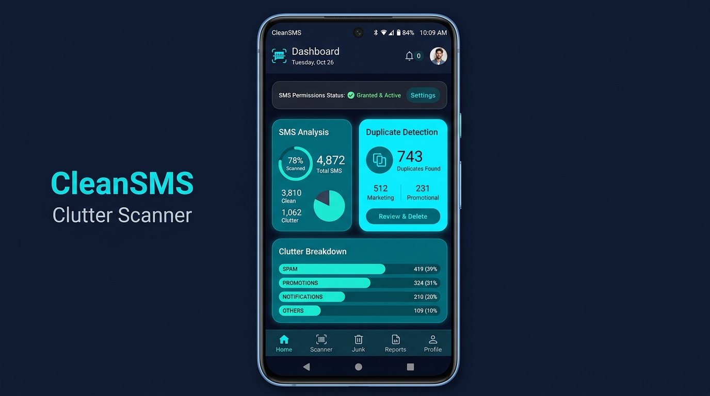
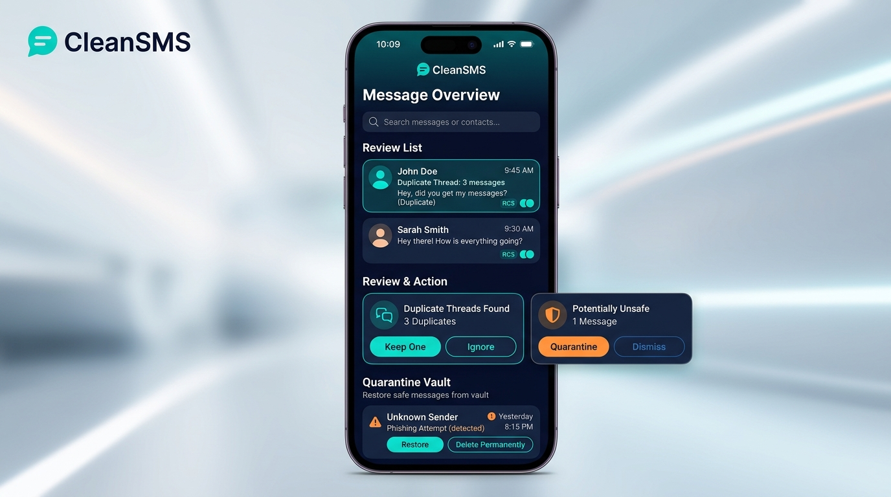

# CleanSMS 💬✨

> **Intelligent SMS & RCS Message Organizer, De-duplicator, and Cleaner for Android & Google Messages.**

[](https://developer.android.com)
[](https://kotlinlang.org)
[](https://developer.android.com/jetpack/compose)
[-informational?style=flat-square)](https://developer.android.com/about/versions)
[-success?style=flat-square)](https://developer.android.com/about/versions)
[](https://github.com)
[](LICENSE)

---

## 📱 Screenshots & Overview

<p align="center">
  
  
</p>

**CleanSMS** safely cleans up clutter, duplicate notifications, expired one-time passwords (OTPs), promotional blasts, and spam messages from your Android messaging inbox while preserving your important conversations, RCS read receipts, and message threads.

---

## 🚀 Key Features

### 1. 🔄 Smart SMS & RCS Chat Deduplication
- **Content & Sender Normalization**: Trims redundant whitespace, normalizes casing, and clusters identical SMS or RCS messages.
- **RCS Thread Integrity**: Correctly recognizes Rich Communication Services (RCS) chats, preserving conversation thread IDs (`threadId`), delivery status, and read receipts (`READ`, `DELIVERED`, `SENT`).
- **Configurable Keep Strategy**: Choose between `KEEP_OLDEST` (preserves original conversation anchor) or `KEEP_NEWEST` (keeps the latest retry).

### 2. 🛡️ Quarantine Vault & Reversible Deletion
- **Zero Accidental Data Loss**: Cleaned messages are moved to an encrypted local **Quarantine Vault** before permanent deletion.
- **Instant Restore**: Inspect message contents, match reasons, and restore any quarantined message back to your active inbox with one tap.
- **Permanent Deletion Protection**: Explicit confirmation dialog safeguards against irreversible removals.

### 3. 🔍 Clutter Classification & Instant Search
- **Expired OTP Detection**: Identifies temporary verification codes (Google `G-`, Facebook `FB-`, banking PINs) while preserving fresh, unexpired codes.
- **Promotional & Spam Filters**: Flags commercial discounts, marketing blasts, and suspicious phishing links.
- **Live Search & Filter Chips**: Filter candidate messages by keyword, sender, or category tab (All, Duplicates, OTPs, Promotions, Spam, Custom Rules) with instant substring search.

### 4. ⚙️ Granular Custom Filter Rules Engine
- User-defined rule engine supporting:
  - Sender match (exact or substring).
  - Keyword matching with **AND** / **OR** logic (`matchAnyKeyword`).
  - Age thresholding (e.g. older than 7, 30, or 90 days).
  - Date ranges with epoch boundary validation.
- Rules can be enabled, disabled, edited, or deleted anytime.

### 5. 🔐 On-Device OAuth Secrets Vault & Cloud Backup
- **Explicit Authorization Gate**: On-device OAuth tokens (Google Drive, Dropbox) are pulled **if and only if** the user explicitly authorises the connection via the `AuthorizeServiceDialog`.
- **Strictly Local Storage**: Pulled secrets and keys are stored exclusively in the app's private sandbox (`LocalAuthTokenStore` + Room `oauth_credentials` entity) and are never exposed or sent to remote servers.
- **Zero Secrets in Git**: No credentials, client secrets, or private keys are ever hardcoded or tracked in version control.
- **One-Tap Revocation & Purge**: Users can revoke service access or permanently wipe all stored credentials via the "Purge All Secrets" button.
- **Portable JSON Snapshots**: Export and restore full encrypted backups of quarantined messages and custom rules.

### 6. 🔒 Android Runtime Permissions Flow (`READ_SMS` & `WRITE_SMS`)
- Fully compliant with modern Android permission guidelines:
  - Requests `READ_SMS` (scan, categorize, and detect clutter) and `WRITE_SMS` (delete duplicates and clean inbox) using `ActivityResultContracts.RequestMultiplePermissions()`.
  - Educational rationale dialog (`SmsPermissionRationaleDialog`) explains permissions clearly before requesting.
  - App Settings redirect (`SmsPermissionSettingsDialog`) if permissions were permanently denied.
  - Live status indicator banner (`SmsPermissionsBanner`) on dashboard.
  - Built-in **Demo Mode** allows exploring all app features with 30+ simulated messages without granting device permissions.

### 7. 📐 Responsive & Adaptive Layouts
- **Tablet & Foldable Support**: Adapts automatically on wide screens (`maxWidth >= 720.dp`) using a side `NavigationRail` and two-column split cards.
- **Compact Phone Layout**: Optimized bottom navigation, segmented tabs, and fluid touch targets (minimum 48dp).

---

## 📦 Package & Android Configuration

| Property | Value |
| :--- | :--- |
| **App Name** | `CleanSMS` |
| **Application ID** | `com.aistudio.cleansms.jrvxpq` |
| **Package Namespace** | `com.example` |
| **Compile SDK** | `Android 16 (API 36.1)` |
| **Target SDK** | `Android 16 (API 36)` |
| **Minimum SDK** | `Android 7.0 (API 24)` |
| **UI Framework** | Jetpack Compose (Material Design 3) |
| **Architecture** | Clean Architecture / MVVM + StateFlow |
| **Local Database** | Room Database v3 (KSP) |
| **Default SMS Role** | Fully eligible with SMS Deliver & Headless Send services |

### Declared System Permissions

```xml
<!-- Manifest Permissions in AndroidManifest.xml -->
<uses-permission android:name="android.permission.READ_SMS" />
<uses-permission android:name="android.permission.WRITE_SMS" />
<uses-permission android:name="android.permission.RECEIVE_SMS" />
<uses-permission android:name="android.permission.RECEIVE_MMS" />
<uses-permission android:name="android.permission.INTERNET" />
<uses-permission android:name="android.permission.ACCESS_NETWORK_STATE" />
```

---

## 🏷️ Release Version Schema

CleanSMS follows strict **Semantic Versioning** (`MAJOR.MINOR.PATCH`):

$$\text{Version Name} = \text{MAJOR}.\text{MINOR}.\text{PATCH}$$

$$\text{Version Code} = (\text{MAJOR} \times 10000) + (\text{MINOR} \times 100) + \text{PATCH}$$

### Version Code Examples

| Release Tag | `versionName` | `versionCode` | Release Stage | Description |
| :--- | :--- | :--- | :--- | :--- |
| `v1.0.0` | `1.0.0` | `10000` | Alpha | Initial prototype, basic deduplication & scanner |
| `v1.1.0` | `1.1.0` | `10100` | Alpha | Custom rules engine, Room Quarantine Vault, JSON backup |
| `v1.2.0` | `1.2.0` | `10200` | Beta | RCS message support, thread cluster deduplication, read receipt preservation |
| `v1.3.0` | `1.3.0` | `10300` | Beta | Reactive foldable & tablet layouts, search bar, secrets audit |
| `v1.4.0` | `1.4.0` | `10400` | Beta | On-device OAuth secret pulling, user authorization gate, local vault storage |
| `v1.5.0` | `1.5.0` | `10500` | Stable / Production | Android Runtime Permissions flow for `READ_SMS` & `WRITE_SMS` |

### Release Tracks

1. **Internal / Alpha (`develop`)**:
   - Automated JVM unit and Robolectric test execution.
   - Verified via `gradle :app:testDebugUnitTest`.
2. **Beta / Open Testing (`main` / `release/*`)**:
   - Signed debug/release APKs for user feedback and multi-device testing.
   - Built via `gradle assembleRelease`.
3. **Production (`production`)**:
   - Google Play Android App Bundle (`.aab`) with ProGuard optimizations.
   - Built via `gradle bundleRelease`.

---

## 🛠️ Project Structure

```
CleanSMS/
├── app/
│   ├── src/
│   │   ├── main/
│   │   │   ├── java/com/example/
│   │   │   │   ├── MainActivity.kt                 # Compose root, navigation, permissions launcher
│   │   │   │   ├── cloud/
│   │   │   │   │   ├── CloudBackupManager.kt       # JSON serialization & snapshot parser
│   │   │   │   │   ├── CloudSecretsConfig.kt       # Safe credential access & masking
│   │   │   │   │   ├── DeviceOAuthManager.kt       # On-device OAuth secret pulling with user consent
│   │   │   │   │   └── LocalAuthTokenStore.kt      # Private on-device credentials vault
│   │   │   │   ├── data/
│   │   │   │   │   ├── SmsClassifier.kt            # Categorization, regex, and duplicate logic
│   │   │   │   │   ├── SmsRepository.kt            # Telephony content provider & demo dataset
│   │   │   │   │   └── local/
│   │   │   │   │       ├── AppDatabase.kt          # Room DB (Quarantine, Rules, Backups, OAuth)
│   │   │   │   │       ├── CleanSmsDao.kt          # Room DAO interfaces & reactive Flows
│   │   │   │   │       └── Entities.kt             # Room table definitions
│   │   │   │   ├── model/                          # Data models & DTOs
│   │   │   │   ├── telephony/                      # Default SMS receivers & services
│   │   │   │   └── ui/
│   │   │   │       ├── CleanSmsViewModel.kt        # State management & business logic
│   │   │   │       ├── components/                 # Dialogs, sheets, message cards, banners
│   │   │   │       ├── screens/                    # Scanner, Review, Vault, RulesAndCloud
│   │   │   │       └── theme/                      # Material 3 ColorScheme, Typography, Shapes
│   │   │   ├── res/                                # Android resource files & drawables
│   │   │   └── AndroidManifest.xml                 # Permissions & system receivers
│   │   └── test/java/com/example/
│   │       ├── DeviceOAuthManagerTest.kt           # Robolectric tests for OAuth pulling & authorization
│   │       ├── ExampleUnitTest.kt                  # 14 comprehensive unit test cases
│   │       └── RuntimePermissionsTest.kt           # Robolectric tests for READ_SMS & WRITE_SMS flow
│   └── build.gradle.kts                            # App module dependencies & SDK config
├── docs/
│   └── screenshots/                                # High-res app preview assets
├── gradle/
│   └── libs.versions.toml                          # Version catalog
├── .env.example                                    # Environment template (no secrets)
├── .gitignore                                      # Comprehensive protection against credentials
├── metadata.json                                   # AI Studio platform identity
└── README.md                                       # Project documentation
```

---

## 🧪 Testing & Verification

The project includes unit and Robolectric test suites covering Critical User Journeys (CUJs):

```bash
# Run all unit and Robolectric tests
gradle :app:testDebugUnitTest

# Compile debug applet
gradle assembleDebug
```

### Verified Test Scenarios

- **Deduplication Edge Cases**: Whitespace and casing normalization, large clusters (5+ copies), master copy preservation.
- **RCS Chat Integrity**: Preserves conversation thread IDs and verifies read receipts (`READ` vs `SENT`).
- **OTP Filtering**: Differentiates between fresh and expired OTP codes; extracts code prefixes (`G-`, `FB-`, PIN).
- **Custom Rule Engine**: Validates AND/OR keyword matching, sender filters, and age boundary calculations.
- **On-Device OAuth Security**: Verifies that pulling device secrets fails with `SecurityException` when unauthorized, and succeeds with masked keys in local storage when authorized.
- **Runtime Permissions**: Validates `READ_SMS` and `WRITE_SMS` state transitions, dual-grant activation, partial grant handling, and rationale/settings dialog lifecycles.

---

## 🔒 Security & Privacy Commitments

1. **No External Transmission**: Message scanning and cleaning are executed 100% on-device.
2. **Opt-In OAuth Connection**: Device OAuth secrets are retrieved **if and only if** you confirm in the authorization dialog.
3. **No Tracked Secrets**: API keys, credentials, and keystore certificates are excluded via `.gitignore` and managed securely via environment configuration.
4. **Reversible Actions**: Quarantine Vault guarantees messages can be restored before permanent deletion.

---

## 📄 License

```
Copyright 2026 shqsid

Licensed under the Apache License, Version 2.0 (the "License");
you may not use this file except in compliance with the License.
You may obtain a copy of the License at

    http://www.apache.org/licenses/LICENSE-2.0
```
